# KAMBAC Integrated Management System (KIMS)

KAMBAC Integrated Management System (KIMS) is a modular platform for managing members, loans, payments, livestock, equipment, livelihood products, attendance, announcements, analytics, and role-based access in one integrated system.

> [!NOTE]
> Assumptions:
> - The proposal names the system domains and tables but not all field-level schema, so added fields in the class and object diagrams are assumptions.
> - Loan and equipment lifecycle states not explicitly named in the proposal are modeled as assumptions.
> - Notification channels, dashboard drill-downs, and any detailed workflow logic beyond the stated scenarios are assumptions.
> - The architecture is modeled as a centralized web application with modular services and a REST API because the proposal describes layered and modular design rather than separate microservices.
> - The sample member ID format `KMB-2026-0001` is used only as an example object value.
> - The use case permissions are aligned to the intended RBAC model, but the detailed matrix cell values were not enumerated in the source text, so they are generalized.
> Mermaid has no native use case, activity, DFD, component, package, object, communication, interaction overview, composite structure or timing diagram, so those use flowcharts, class diagrams or a Gantt chart.

## Contents

| No. | Diagram | Type |
| --- | --- | --- |
| 1 | System Architecture | Structural |
| 2 | Class | Structural |
| 3 | Component | Structural |
| 4 | Deployment | Structural |
| 5 | Object | Structural |
| 6 | Package | Structural |
| 7 | Composite Structure | Structural |
| 8 | Data Flow Diagram Level 1 | Behavioral |
| 9 | Use Case | Behavioral |
| 10 | Activity | Behavioral |
| 11 | Sequence | Behavioral |
| 12 | State Machine | Behavioral |
| 13 | Communication | Behavioral |
| 14 | Interaction Overview | Behavioral |
| 15 | Timing | Behavioral |
| 16 | Requirement | Behavioral |

## Diagram 1: System Architecture (Structural)
Layered KIMS architecture showing user roles, business modules, the REST API, RBAC middleware, database, notification module, and off-site backup.

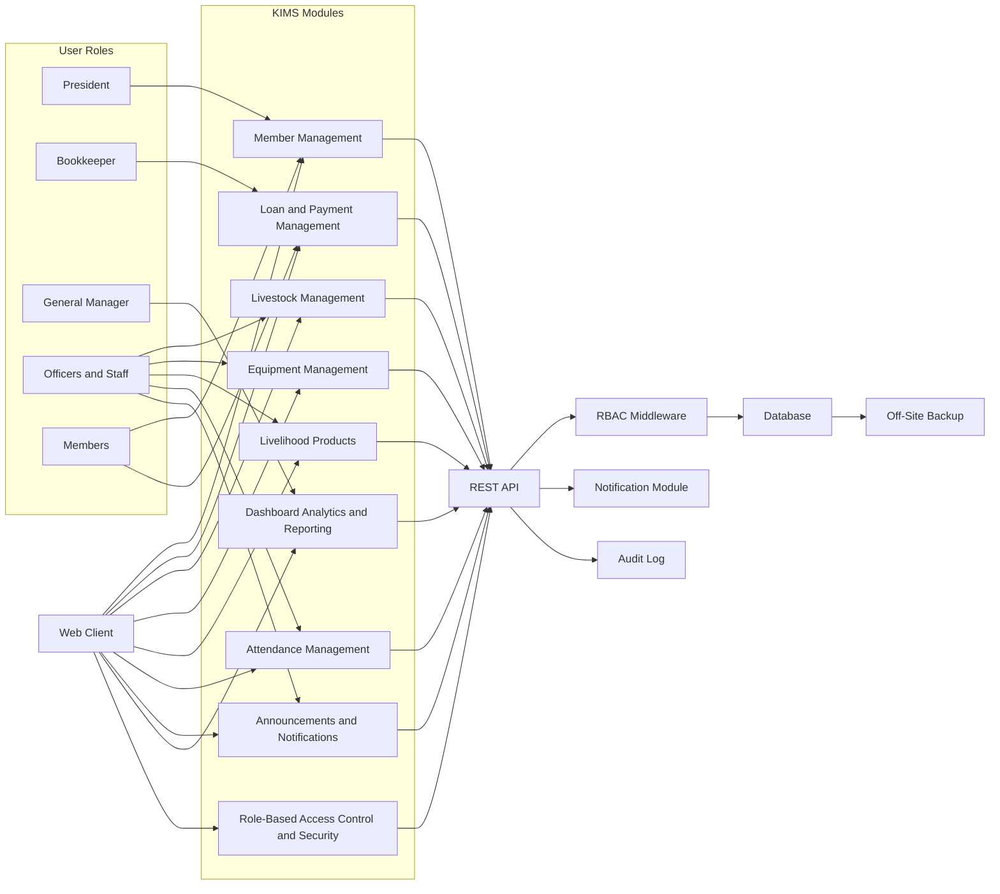

Note: This is a layered architecture view approximating a UML system architecture.

## Diagram 2: Class (Structural)
Core domain model for the master tables and transactional records, with sample class relationships for the proposal's management domains.

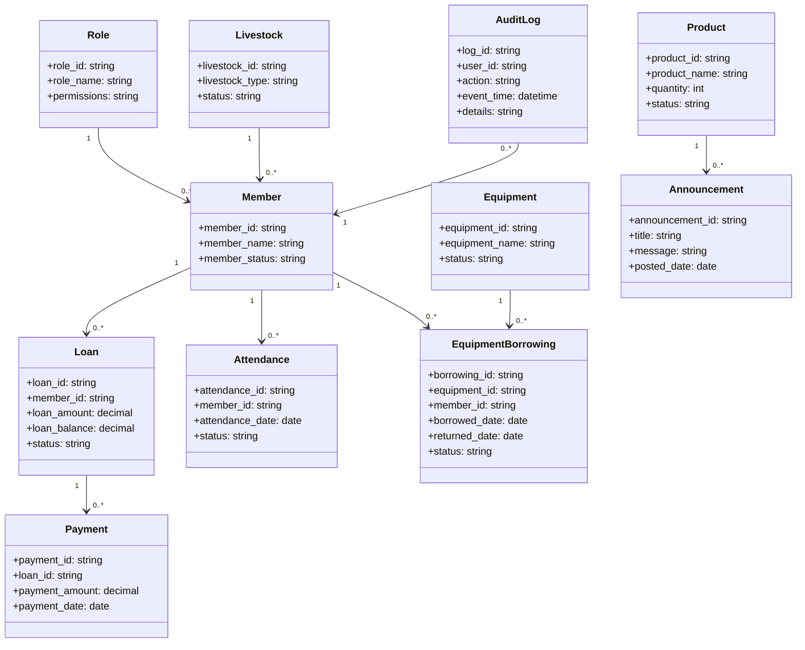

Note: This is a domain model approximation because the proposal does not provide full field-level schemas.

## Diagram 3: Component (Structural)
Application component view showing form validation, RBAC enforcement, business services, repository access, audit logging, and notifications.

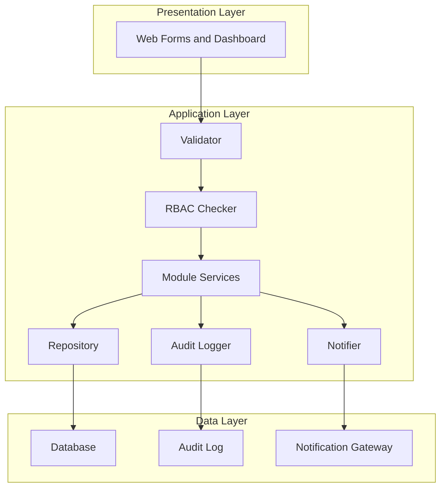

Note: This is an approximate UML component diagram using a flowchart.

## Diagram 4: Deployment (Structural)
Deployment view for the KIMS hosting environment, web server, application server, DBMS, and off-site backup infrastructure.

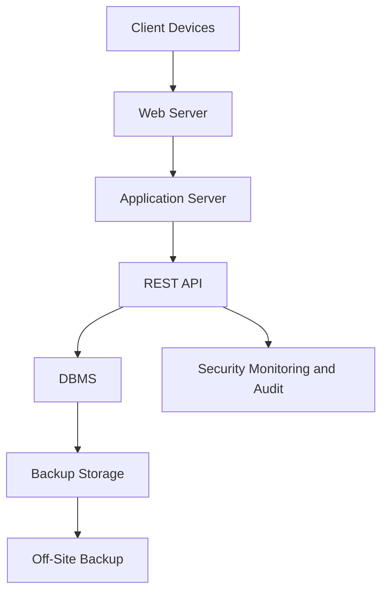

Note: This is an approximate UML deployment diagram using a flowchart.

## Diagram 5: Object (Structural)
Example object instances using the proposed master and transactional tables, with sample member ID values.

```mermaid
classDiagram
    class "Member: KMB-2026-0001" {
        member_id = "KMB-2026-0001"
        member_name = "Sample Member"
        member_status = "Active"
    }

    class "Role: Bookkeeper" {
        role_id = "ROL-02"
        role_name = "Bookkeeper"
        permissions = "loan approval, payment posting"
    }

    class "Loan: LN-2026-0001" {
        loan_id = "LN-2026-0001"
        member_id = "KMB-2026-0001"
        loan_amount = 15000.00
        loan_balance = 6500.00
        status = "Active"
    }

    class "Payment: PY-2026-0001" {
        payment_id = "PY-2026-0001"
        loan_id = "LN-2026-0001"
        payment_amount = 2500.00
        payment_date = "2026-02-05"
    }

    class "Livestock: LV-2026-0001" {
        livestock_id = "LV-2026-0001"
        livestock_type = "Carabao"
        status = "Assigned"
    }

    class "Equipment: EQ-2026-0001" {
        equipment_id = "EQ-2026-0001"
        equipment_name = "Tractor"
        status = "Available"
    }

    class "EquipmentBorrowing: EB-2026-0001" {
        borrowing_id = "EB-2026-0001"
        equipment_id = "EQ-2026-0001"
        member_id = "KMB-2026-0001"
        borrowed_date = "2026-02-07"
        returned_date = "2026-02-10"
        status = "Returned"
    }

    class "Product: PD-2026-0001" {
        product_id = "PD-2026-0001"
        product_name = "Rice Seed"
        quantity = 120
        status = "Available"
    }

    class "Attendance: AT-2026-0001" {
        attendance_id = "AT-2026-0001"
        member_id = "KMB-2026-0001"
        attendance_date = "2026-02-08"
        status = "Present"
    }

    class "Announcement: AN-2026-0001" {
        announcement_id = "AN-2026-0001"
        title = "General Assembly"
        message = "Schedule update"
        posted_date = "2026-02-06"
    }

    class "AuditLog: AD-2026-0001" {
        log_id = "AD-2026-0001"
        user_id = "KMB-2026-0001"
        action = "Loan approved"
        event_time = "2026-02-04T10:00:00"
        details = "Approval recorded"
    }
```

Note: This is an object-view approximation because Mermaid does not have a native object diagram in the simplified form used here.

## Diagram 6: Package (Structural)
Package decomposition for the KIMS presentation, application modules, security, and data layers.

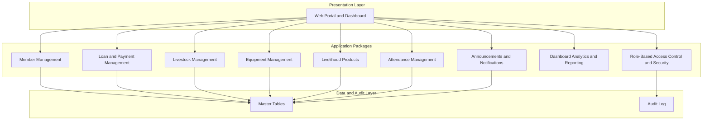

Note: This is an approximate UML package diagram using subgraphs.

## Diagram 7: Composite Structure (Structural)
Internal architecture of the REST API and application layer showing validation, access control, business services, repository, auditing, and notification responsibilities.

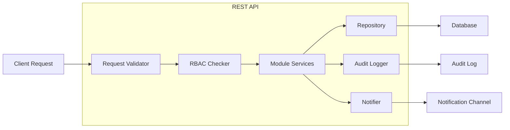

Note: This is an approximate UML composite structure using a flowchart.

## Diagram 8: Data Flow Diagram Level 1 (Behavioral)
Level 1 DFD showing the main roles, the system processes, and the master tables used to persist KIMS records.

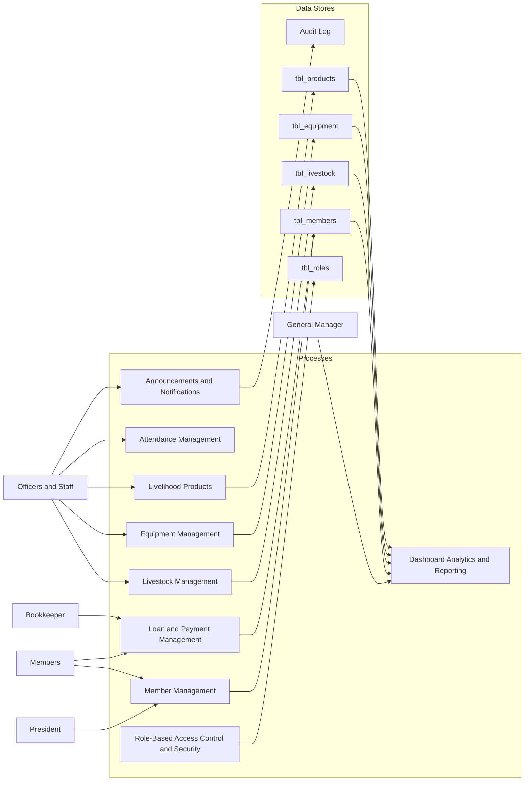

Note: This is a data-flow style approximation, not a native DFD diagram.

## Diagram 9: Use Case (Behavioral)
Core user interactions for all proposal-defined roles and the workflow areas tied to the RBAC model.

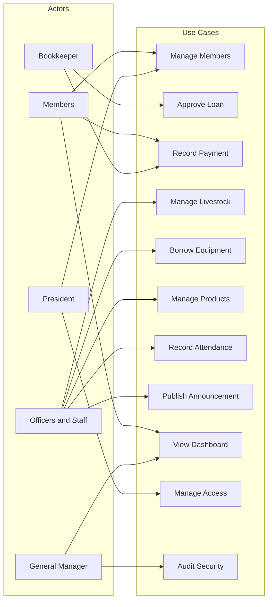

Note: This is a flowchart approximation of a UML use case diagram.

## Diagram 10: Activity (Behavioral)
Loan workflow showing member request, Bookkeeper approval, payment entry, and balance update.

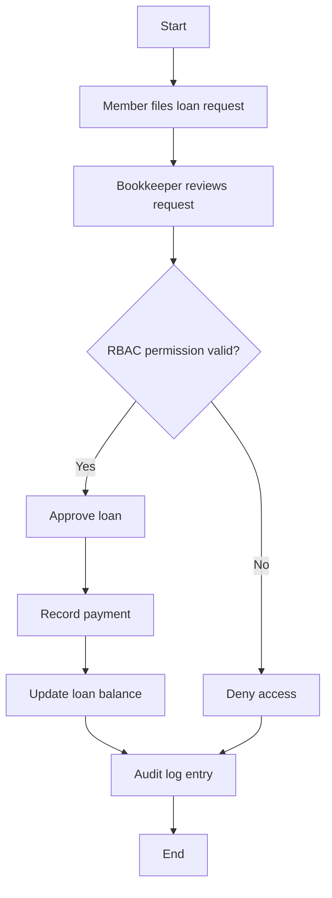

Note: This is a flowchart approximation of a UML activity diagram.

## Diagram 11: Sequence (Behavioral)
Loan request and payment flow with an unauthorized access branch for a 403 Forbidden result.

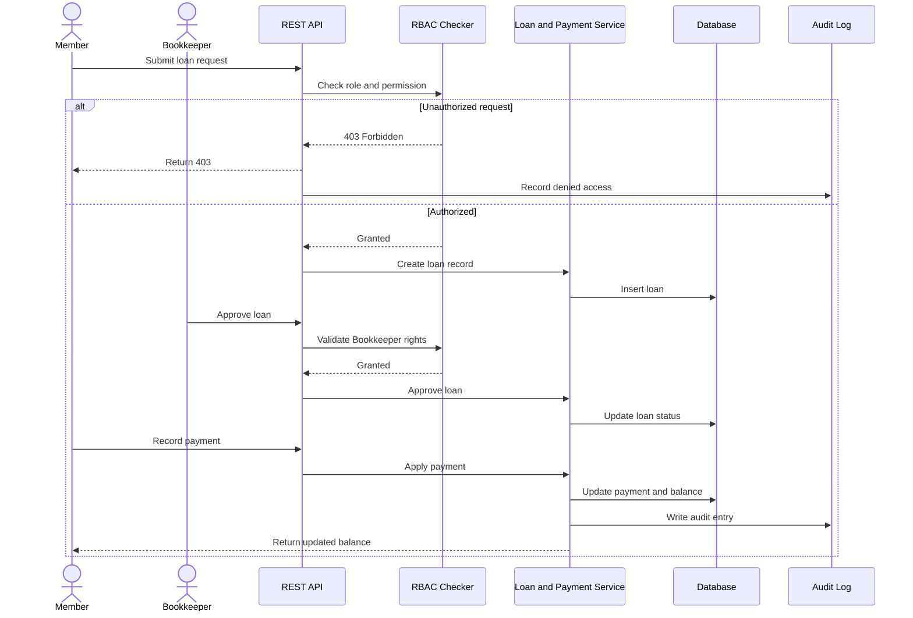

Note: This is a sequence diagram showing the proposal's loan scenario and RBAC denial path.

## Diagram 12: State Machine (Behavioral)
Loan lifecycle from application through approval, activity, payment, and closure, with assumption states included where the proposal does not define them explicitly.

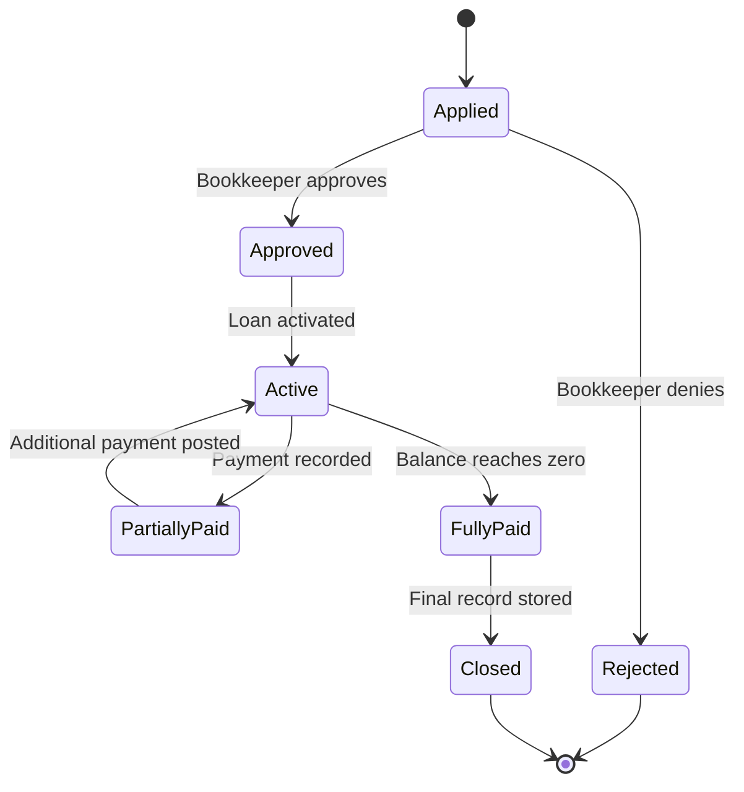

Note: Assumption states include Rejected, PartiallyPaid, and Closed because the proposal only signals the overall loan lifecycle without naming each state.

## Diagram 13: Communication (Behavioral)
Message exchange for loan approval and payments between the member, Bookkeeper, services, database, and audit log.

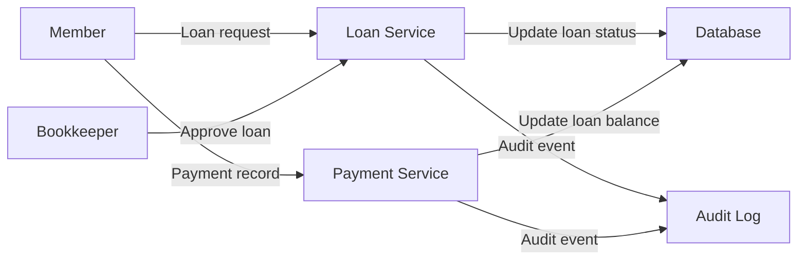

Note: This is a communication-style flowchart approximation.

## Diagram 14: Interaction Overview (Behavioral)
Combined interaction view for the loan, livestock assignment, and equipment borrowing scenarios.

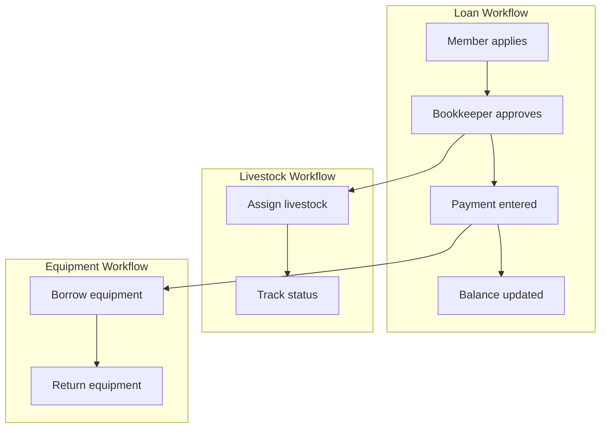

Note: This is an interaction-overview style synthesis of the proposal's main operational scenarios.

## Diagram 15: Timing (Behavioral)
Example timeline for a user session, loan balance progression, equipment status changes, and audit log events using a Gantt chart because Mermaid has no native timing diagram.

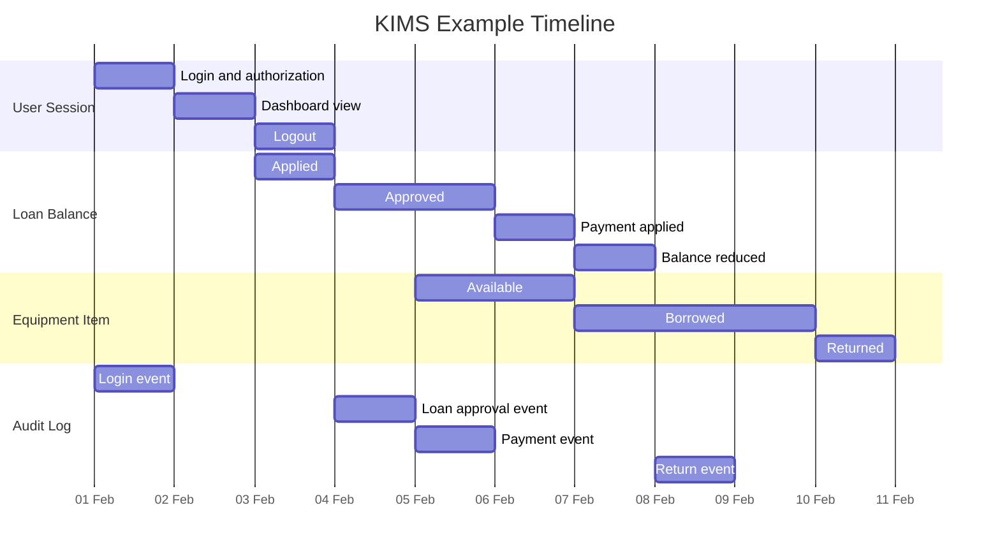

Note: This is a Gantt chart approximation of a UML timing diagram.

## Diagram 16: Requirement (Behavioral)
Requirements traceability linking modules to requirements and to validation scenarios from the proposal.

```mermaid
requirementDiagram

    requirement "R1 Member data integrity" {
        id: 1
        text: The system shall maintain member records in the approved member table.
        risk: high
        verifymethod: test
    }

    requirement "R2 Loan and payment accuracy" {
        id: 2
        text: The system shall keep loan balances and payment records synchronized.
        risk: high
        verifymethod: test
    }

    requirement "R3 Livestock traceability" {
        id: 3
        text: The system shall maintain livestock records and assignment status.
        risk: medium
        verifymethod: inspection
    }

    requirement "R4 Equipment borrowing control" {
        id: 4
        text: The system shall track equipment borrowing and return status.
        risk: medium
        verifymethod: test
    }

    requirement "R5 Backup and recovery" {
        id: 5
        text: The system shall support backup, recovery, and continuity.
        risk: high
        verifymethod: test
    }

    requirement "R6 Security and audit" {
        id: 6
        text: The system shall enforce RBAC, encryption, and audit logging.
        risk: high
        verifymethod: inspection
    }

    element "Member Management" {}
    element "Loan and Payment Management" {}
    element "Livestock Management" {}
    element "Equipment Management" {}
    element "Backup and Recovery" {}
    element "Role-Based Access Control and Security" {}

    testCase "TC-01 Member registration" {}
    testCase "TC-02 Loan approval and payment" {}
    testCase "TC-03 Livestock assignment" {}
    testCase "TC-04 Equipment return" {}
    testCase "TC-05 Backup restore" {}
    testCase "TC-06 RBAC and audit log" {}

    "Member Management" -- satisfies --> "R1"
    "Loan and Payment Management" -- satisfies --> "R2"
    "Livestock Management" -- satisfies --> "R3"
    "Equipment Management" -- satisfies --> "R4"
    "Backup and Recovery" -- satisfies --> "R5"
    "Role-Based Access Control and Security" -- satisfies --> "R6"

    "TC-01 Member registration" -- verifies --> "R1"
    "TC-02 Loan approval and payment" -- verifies --> "R2"
    "TC-03 Livestock assignment" -- verifies --> "R3"
    "TC-04 Equipment return" -- verifies --> "R4"
    "TC-05 Backup restore" -- verifies --> "R5"
    "TC-06 RBAC and audit log" -- verifies --> "R6"
```

Note: This is a requirement-traceability diagram approximating a UML requirement model.

