# KAMBAC Integrated Management System (KIMS)

KAMBAC Integrated Management System (KIMS) is the proposed integrated platform for managing member records, loans and payments, livestock assignments, equipment borrowing, product inventory, attendance, announcements, reporting, and security/audit processes across the KAMBAC organization.

> [!NOTE]
> Assumptions used for this README:
> - The proposal defines the modules, roles, master tables, data flows, and security controls but does not provide full field-level schemas for every table, so the class/object diagrams include representative attributes only.
> - Loan lifecycle states not explicitly named in the proposal are modeled as assumptions: Applied, Approved, Active, Partially Paid, Fully Paid, Rejected, and Overdue.
> - Equipment borrowing states are represented as Available, Borrowed, and Returned for the timing diagram, as a general UML-style lifecycle simplification.
> - The proposal names a layered, modular RESTful architecture; this README treats it as a single web application with modular services rather than a microservice topology.
> - The user roles are President, Bookkeeper, General Manager, Officers and Staff, and Members, as stated in Section VI.
> - The master tables referenced in Section XI are treated consistently as tbl_members, tbl_roles, tbl_equipment, tbl_livestock, and tbl_products.
> - The proposal guidance for loan, livestock, and equipment workflows is translated into simplified example scenarios for the behavioral diagrams.
>
> "Mermaid has no native use case, activity, DFD, component, package, object, communication, interaction overview, or timing diagrams. These are approximated using flowchart, sequence, class, state, requirement, and gantt diagrams in this README."

## Contents

| No. | Diagram | Type |
| --- | --- | --- |
| 1 | System Architecture | Structural |
| 2 | Class | Structural |
| 3 | Component | Structural |
| 4 | Deployment | Structural |
| 5 | Object | Structural |
| 6 | Package | Structural |
| 7 | Composite Structure | Structural |
| 8 | Data Flow Diagram Level 1 | Behavioral |
| 9 | Use Case | Behavioral |
| 10 | Activity | Behavioral |
| 11 | Sequence | Behavioral |
| 12 | State Machine | Behavioral |
| 13 | Communication | Behavioral |
| 14 | Interaction Overview | Behavioral |
| 15 | Timing | Behavioral |
| 16 | Requirement | Behavioral |

## Diagram 1: System Architecture (Structural)
Layered KIMS architecture showing core modules, REST API, RBAC middleware, database, notifications, audit, and off-site backup.

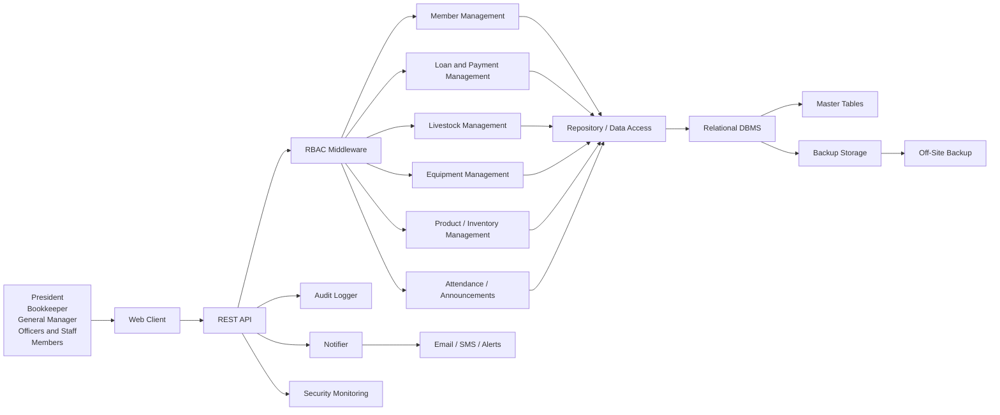

Note: This is a simplified architecture view derived from the layered and modular design described in Sections VIII, X, XII, and XV.

## Diagram 2: Class (Structural)
Domain model for the core entities and relationships among members, roles, loans, payments, livestock, equipment, products, attendance, announcements, and audit records.

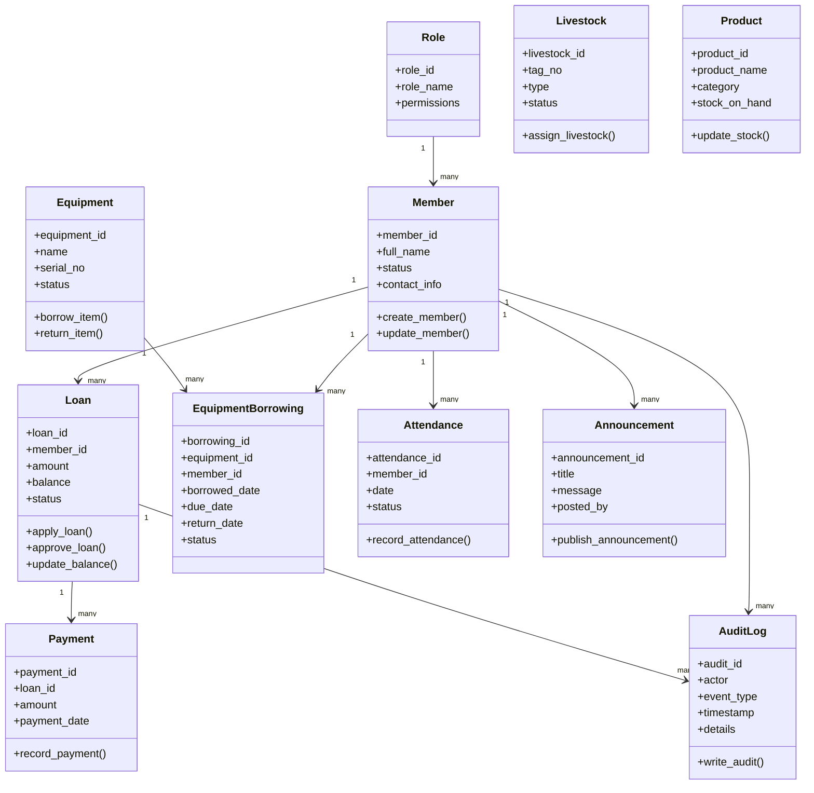

Note: This class model is based on the data model and master tables described in Sections VI and XI.

## Diagram 3: Component (Structural)
Logical components of the KIMS application layer and data-access path.

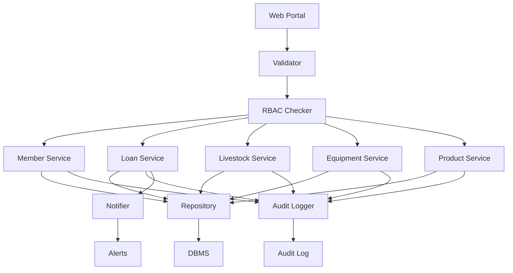

Note: This flowchart approximates the modular application architecture described in Sections VIII and X.

## Diagram 4: Deployment (Structural)
Deployment view of the KIMS hosting environment, web server, DBMS, backup infrastructure, and monitoring.

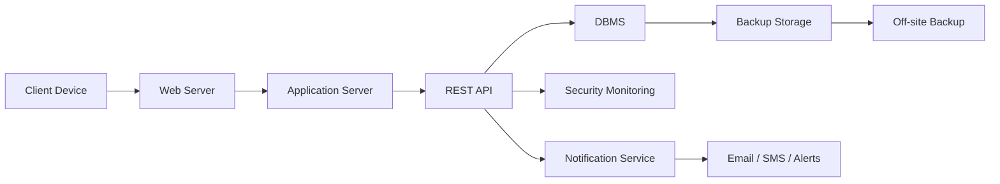

Note: This deployment model reflects the hosting and infrastructure guidance in Sections XII and XV.

## Diagram 5: Object (Structural)
Representative object instances for key KIMS records using sample values.

```mermaid
classDiagram
    class "Member: M-1001" {
        member_id = "M-1001"
        full_name = "Sample Member"
        status = "Active"
    }

    class "Role: Bookkeeper" {
        role_name = "Bookkeeper"
        permissions = "Loan approval, payment posting"
    }

    class "Loan: L-2201" {
        loan_id = "L-2201"
        member_id = "M-1001"
        amount = 25000
        balance = 6500
        status = "Approved"
    }

    class "Payment: P-3301" {
        payment_id = "P-3301"
        loan_id = "L-2201"
        amount = 5000
        payment_date = "2026-11-02"
    }

    class "Livestock: LV-01" {
        livestock_id = "LV-01"
        tag_no = "K001"
        type = "Carabao"
        status = "Assigned"
    }

    class "Equipment: EQ-42" {
        equipment_id = "EQ-42"
        name = "Tractor"
        status = "Available"
    }

    class "EquipmentBorrowing: EB-01" {
        borrowing_id = "EB-01"
        equipment_id = "EQ-42"
        member_id = "M-1001"
        status = "Borrowed"
    }

    class "Product: PR-18" {
        product_id = "PR-18"
        product_name = "Rice Seed"
        stock_on_hand = 120
    }

    class "Attendance: AT-01" {
        attendance_id = "AT-01"
        member_id = "M-1001"
        date = "2026-11-02"
        status = "Present"
    }

    class "AuditLog: AD-01" {
        audit_id = "AD-01"
        actor = "Bookkeeper"
        event_type = "Loan Approved"
        timestamp = "2026-11-02T09:30:00"
    }
```

Note: This is a representative object instance diagram derived from the data model in Sections VI and XI.

## Diagram 6: Package (Structural)
High-level package grouping across modules, security, and data persistence.

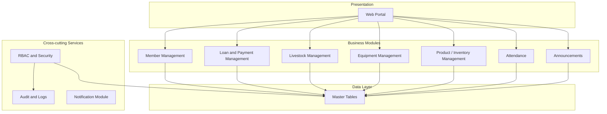

Note: This package grouping approximates the modular design described in Sections VIII and X.

## Diagram 7: Composite Structure (Structural)
Internal composition of the application layer and REST API with validation, RBAC, repositories, notifier, and audit.

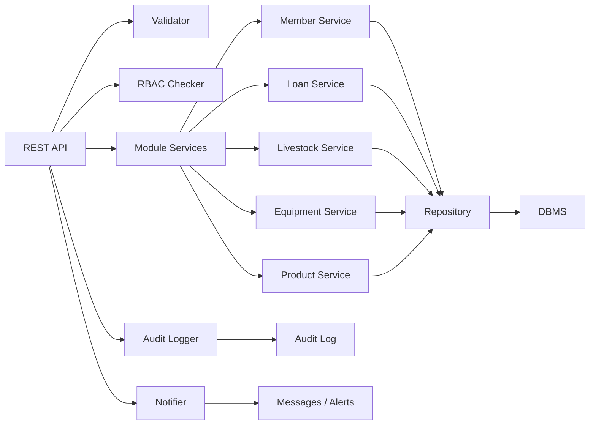

Note: This is a simplified composite structure based on the internal application-layer design in Sections VIII and X.

## Diagram 8: Data Flow Diagram Level 1 (Behavioral)
External roles interact with the main modules, which persist data in the master tables and audit log.

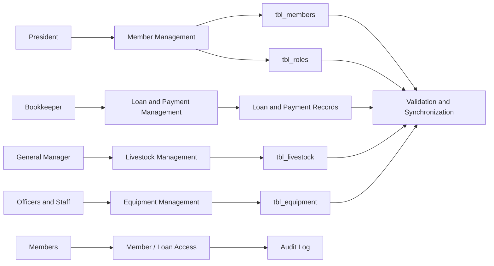

Note: This broad DFD approximation follows Section XIV for form-to-database flow and Sections XI and XIII for tables and audit/security processing.

## Diagram 9: Use Case (Behavioral)
User roles and the main use cases associated with member management, rentals, livestock, equipment, attendance, and security administration.

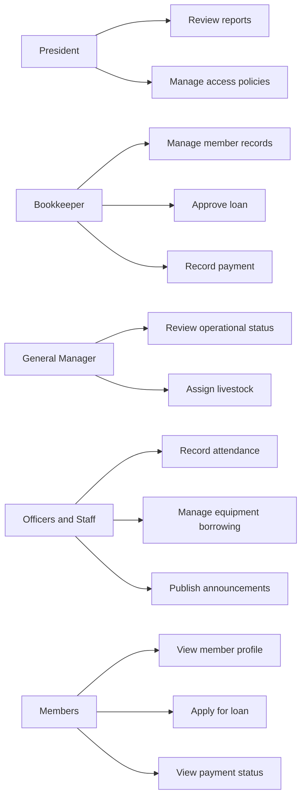

Note: This approximates the role actors and use-case areas defined in Sections VI and XIII.

## Diagram 10: Activity (Behavioral)
Loan workflow from application through approval, payment entry, balance update, and audit logging.

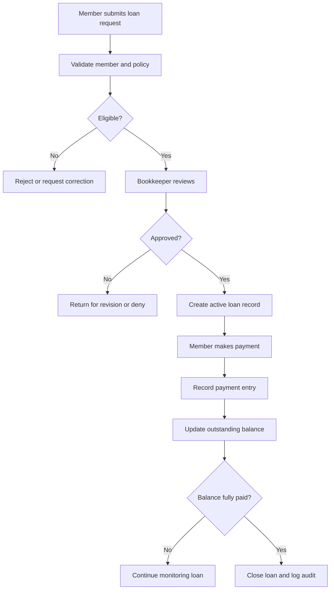

Note: This follows the loan workflow described in Section XVII and the form-to-database flow in Section XIV.

## Diagram 11: Sequence (Behavioral)
Sequence for the primary loan scenario: member request, bookkeeper approval, payment posting, balance change, and audit log entry.

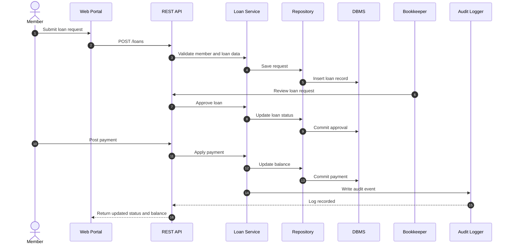

Note: This is based on the loan scenario, approval logic, and balance update guidance in Sections XIV and XVII.

## Diagram 12: State Machine (Behavioral)
Loan lifecycle states and transitions through approval, payment, and closure.

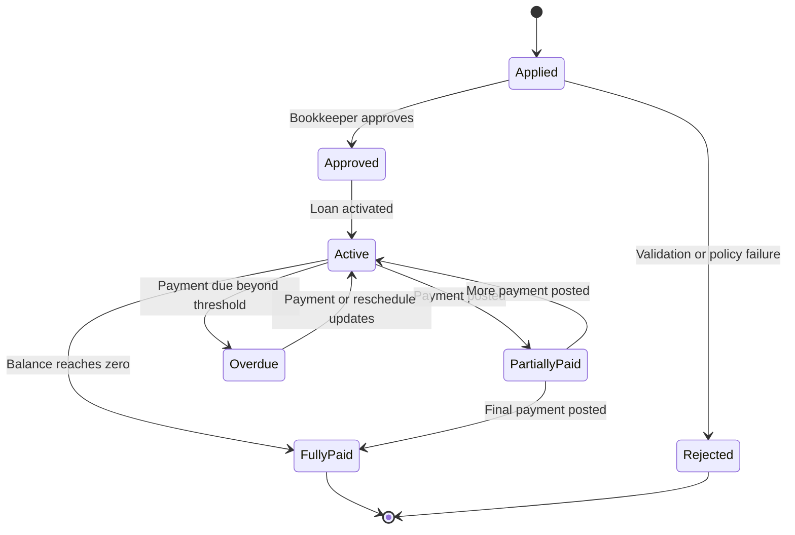

Note: The proposal does not name every state; the additional states are assumptions added for readability and completeness.

## Diagram 13: Communication (Behavioral)
Representative message exchange among the member, Bookkeeper, services, database, and audit log for the loan and payment process.

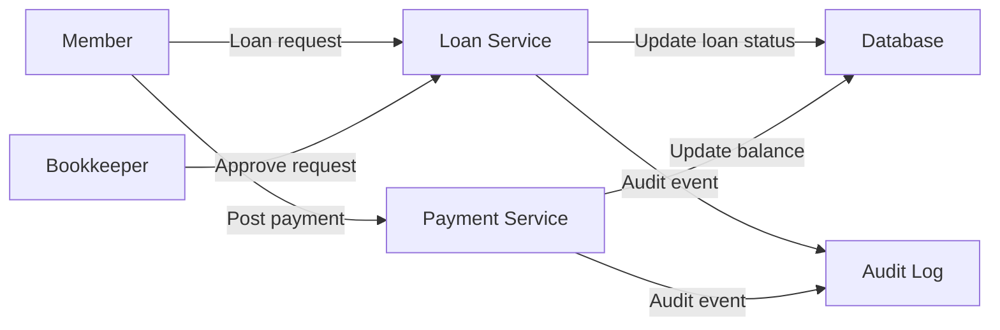

Note: This communication view expresses the message paths described in the loan workflow and security/audit guidance.

## Diagram 14: Interaction Overview (Behavioral)
Combined interaction patterns for the loan, livestock assignment, and equipment borrowing scenarios.

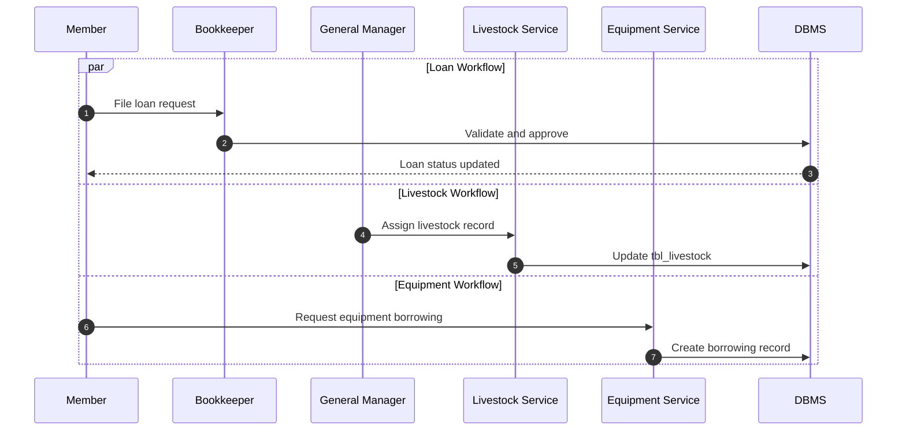

Note: This combines the proposal’s loan, livestock assignment, and equipment borrowing examples into a single overview.

## Diagram 15: Timing (Behavioral)
Example timeline for a user session, loan balance, equipment state, and audit log entries using a Gantt chart.

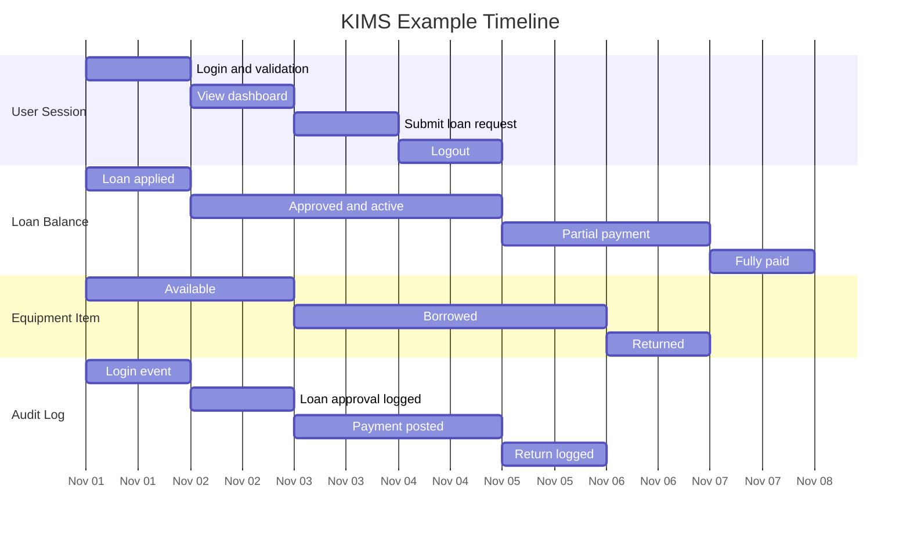

Note: Mermaid has no native timing diagram, so this Gantt chart is used as the closest equivalent to the proposal’s example timeline requirement.

## Diagram 16: Requirement (Behavioral)
Requirements traceability linking security, master-data integrity, transactional processing, and recovery controls to business modules and validation scenarios.

```mermaid
requirementDiagram
    requirement R1 {
      id: 1
      text: "Member records and role assignments must remain valid and traceable."
    }

    requirement R2 {
      id: 2
      text: "Loan applications and payment postings must be approved and synchronized with balances."
    }

    requirement R3 {
      id: 3
      text: "Livestock records must track assignments and operational status."
    }

    requirement R4 {
      id: 4
      text: "Equipment borrowing and return must be tracked and controlled."
    }

    requirement R5 {
      id: 5
      text: "Products and inventory must be tracked and updated consistently."
    }

    requirement R6 {
      id: 6
      text: "RBAC, encryption, audit logs, and backup/recovery must protect operations and support recovery."
    }

    element MemberModule
    element LoanModule
    element LivestockModule
    element EquipmentModule
    element ProductModule
    element SecurityModule

    testCase TC01
    testCase TC02
    testCase TC03
    testCase TC04
    testCase TC05
    testCase TC06

    R1 - satisfies -> MemberModule
    R2 - satisfies -> LoanModule
    R3 - satisfies -> LivestockModule
    R4 - satisfies -> EquipmentModule
    R5 - satisfies -> ProductModule
    R6 - satisfies -> SecurityModule

    R1 - verifies -> TC01
    R2 - verifies -> TC02
    R3 - verifies -> TC03
    R4 - verifies -> TC04
    R5 - verifies -> TC05
    R6 - verifies -> TC06
```

Note: This requirement diagram is derived from the scope, master-data, security, and recovery guidance in Sections V, VI, XI, XIII, and XIX.
